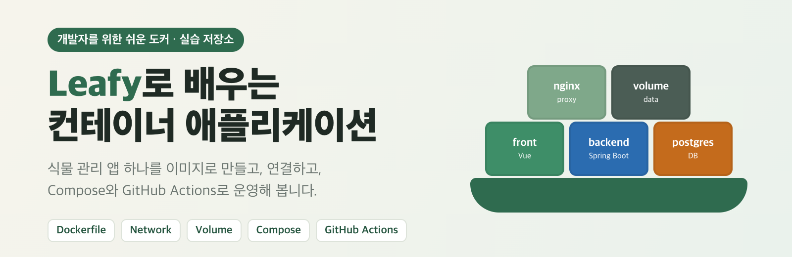
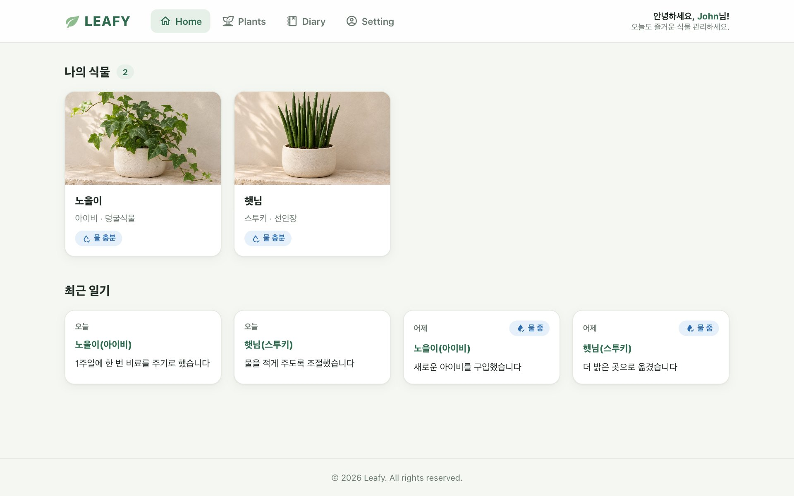
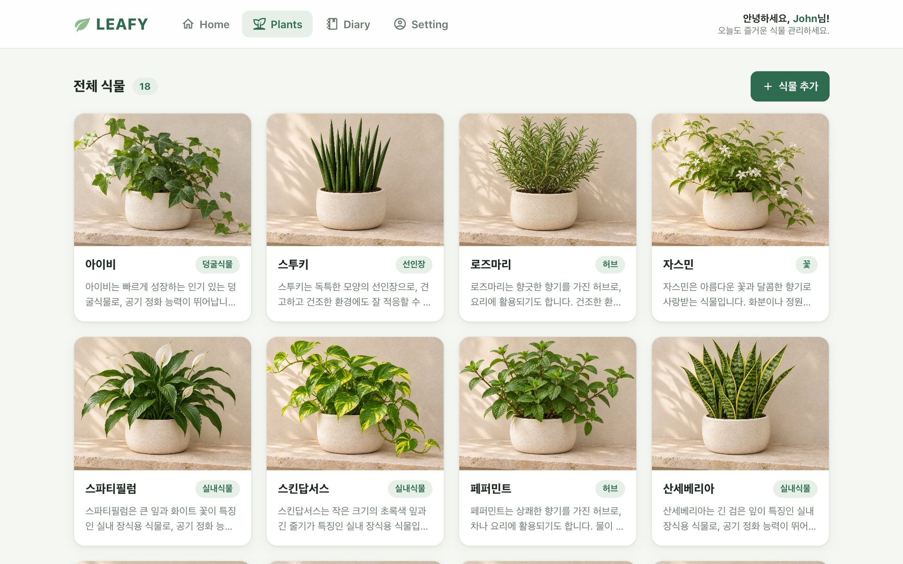
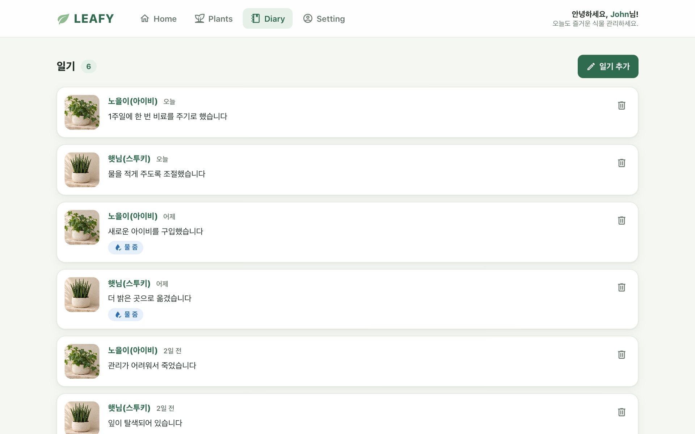
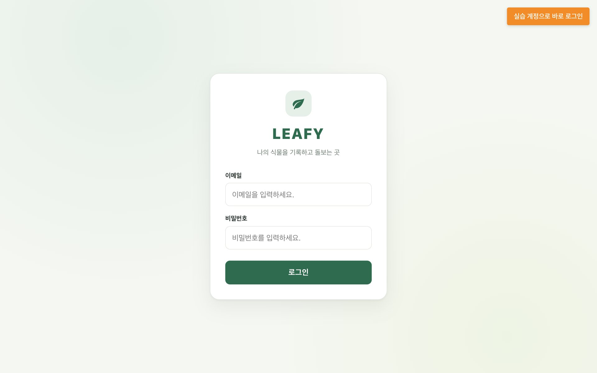
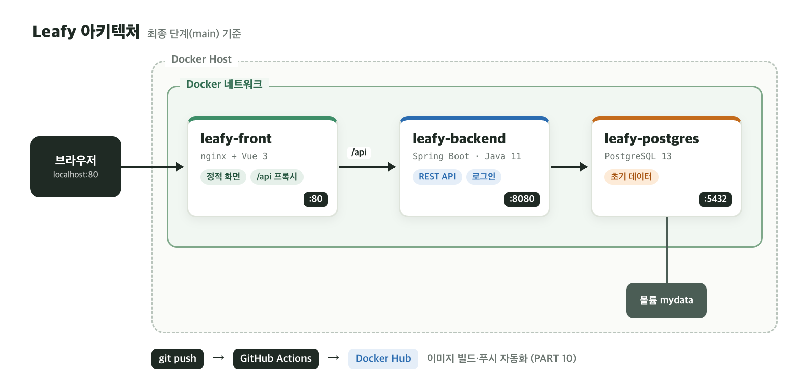
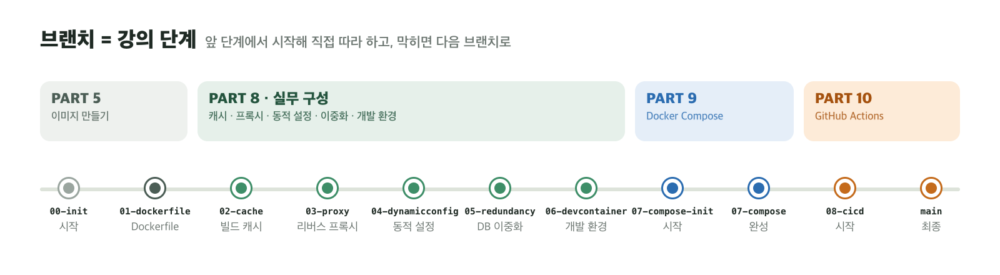

<p align="center"><a href="README.md">English</a> | <b>한국어</b></p>

<p align="center">
  
</p>

<p align="center">
  
  
  
  
  
  
</p>

# 🌿 Leafy

**「개발자를 위한 쉬운 도커」 강의의 메인 실습 저장소입니다.**

Leafy는 내 식물을 등록하고, 물 준 날과 관리 일기를 기록하는 웹 서비스입니다.
강의에서는 이 앱 하나를 가지고 이미지 만들기 → 컨테이너 연결 → 실무 구성 → Compose → CI/CD까지 차례로 완성해 갑니다.

<table>
  <tr>
    <td width="50%"></td>
    <td width="50%"></td>
  </tr>
  <tr>
    <td align="center">홈 · 내 식물과 최근 일기</td>
    <td align="center">식물 도감</td>
  </tr>
  <tr>
    <td width="50%"></td>
    <td width="50%"></td>
  </tr>
  <tr>
    <td align="center">관리 일기</td>
    <td align="center">로그인 · 실습 계정으로 바로 로그인</td>
  </tr>
</table>

---

## 🧭 아키텍처

<p align="center">
  
</p>

| 폴더 | 역할 | 기술 |
|---|---|---|
| [`leafy-frontend`](leafy-frontend) | 화면. nginx가 정적 파일을 제공하고 `/api` 요청을 백엔드로 넘김 | Vue 3, Vuetify, nginx |
| [`leafy-backend`](leafy-backend) | REST API, 로그인 | Spring Boot 2.7, Java 11, Gradle |
| [`leafy-postgresql`](leafy-postgresql) | 데이터베이스와 실습용 초기 데이터 | PostgreSQL 13 |

---

## 🌱 브랜치 = 강의 단계

<p align="center">
  
</p>

브랜치 하나가 강의 한 단계의 **완성된 상태**입니다.
실습을 시작할 때는 **바로 앞 단계 브랜치**로 이동해서 직접 따라 하고, 막히거나 건너뛰고 싶으면 **그 단계 브랜치**로 이동하면 됩니다.

```bash
git clone https://github.com/daintree-henry/leafy.git
cd leafy
git switch 01-dockerfile
```

작업하던 내용을 버리고 다른 브랜치로 옮길 때는 아래 명령을 먼저 실행합니다.

```bash
git reset --hard HEAD && git clean -fd
```

| 브랜치 | 강의 | 이 단계에서 하는 것 |
|---|---|---|
| `00-init` | PART 5 | 시작 상태. Dockerfile 없이 소스만 있음 |
| `01-dockerfile` | PART 5 | 프론트·백엔드·DB를 각각 이미지로 만들기 |
| `02-cache` | PART 8 | 레이어 캐시를 살리는 Dockerfile |
| `03-proxy` | PART 8 | nginx 리버스 프록시로 API 연결 |
| `04-dynamicconfig` | PART 8 | 실행할 때 환경 변수로 설정 넣기 |
| `05-redundancy` | PART 8 | 데이터베이스 이중화 |
| `06-devcontainer` | PART 8 | 컨테이너 안에서 개발하고 디버깅하기 |
| `07-compose-init` | PART 9 | Docker Compose 시작 |
| `07-compose` | PART 9 | Compose로 전체 서비스 구성 완성 |
| `08-cicd` | PART 10 | GitHub Actions로 이미지 빌드·푸시 시작 |
| `main` | PART 10 | 최종 상태 |

> 💡 일부 브랜치에는 강의 중에 함께 찾아 고치는 부분이 있습니다. 강의 순서대로 진행해 주세요.

---

## ⚡ 바로 실행해 보기

강의에서 만드는 완성 이미지로 전체 서비스를 바로 띄워 볼 수 있습니다.

```bash
docker network create leafy-network
docker run -d --name leafy-postgres --network leafy-network devwikirepo/leafy-postgres:1.0.0
docker run -d -p 8080:8080 -e DB_URL=leafy-postgres --network leafy-network --name leafy devwikirepo/leafy-backend:1.0.0
docker run -d -p 80:80 --network leafy-network --name leafy-front devwikirepo/leafy-frontend:1.0.0
```

브라우저에서 **http://localhost** 에 접속한 뒤, 오른쪽 위의 **실습 계정으로 바로 로그인** 버튼을 누르면 됩니다.

| 실습 계정 | |
|---|---|
| 이메일 | `john123@qmail.com` |
| 비밀번호 | `password123` |

정리할 때는 아래 명령을 실행합니다.

```bash
docker rm -f leafy-front leafy leafy-postgres
docker network rm leafy-network
```

---

## 📺 강의

이 저장소는 **「개발자를 위한 쉬운 도커」** 강의의 실습 코드입니다. 강의 영상과 함께 보면 각 단계를 순서대로 따라 할 수 있습니다.

- 함께 쓰는 실습 저장소: [build](https://github.com/daintree-henry/build)
