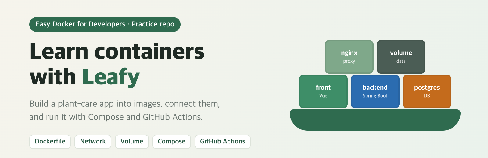
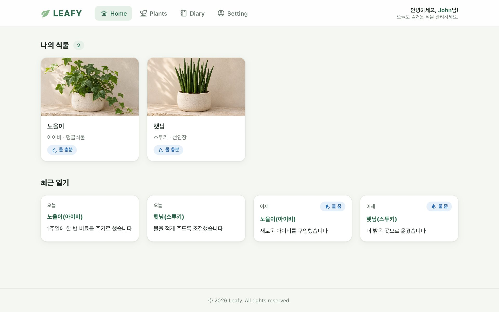
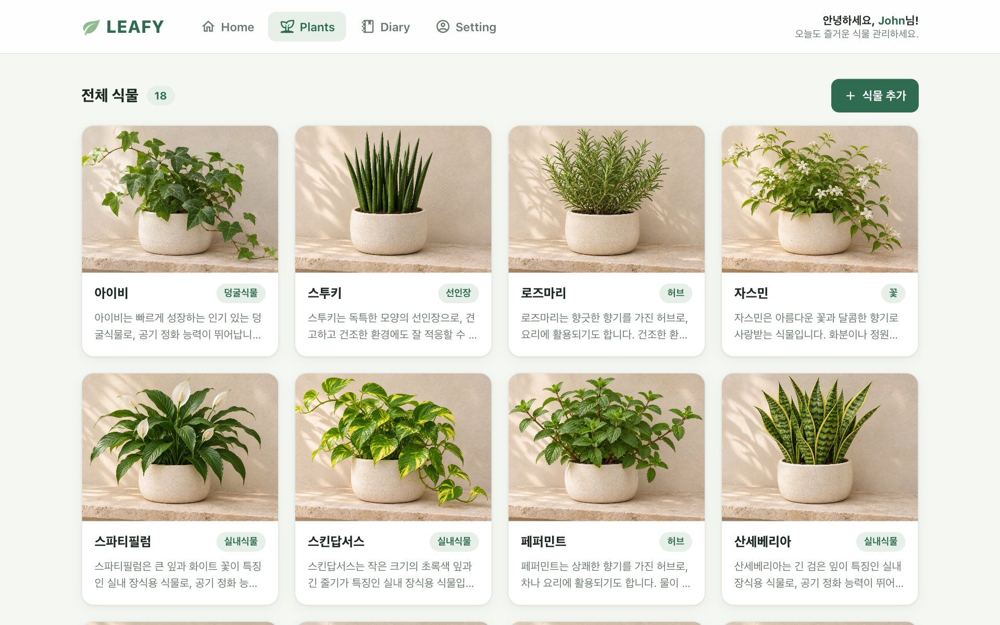
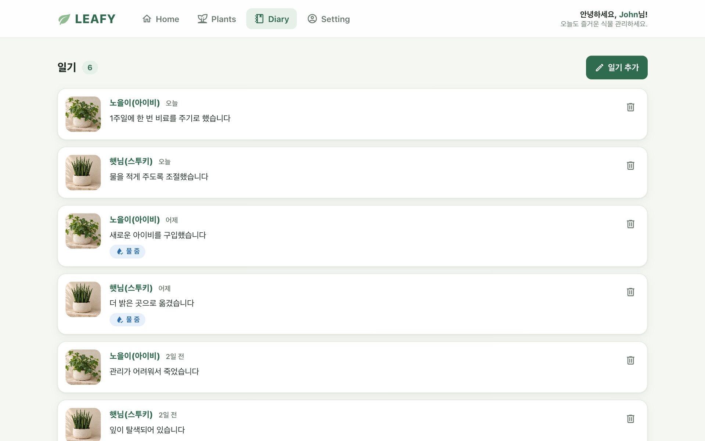
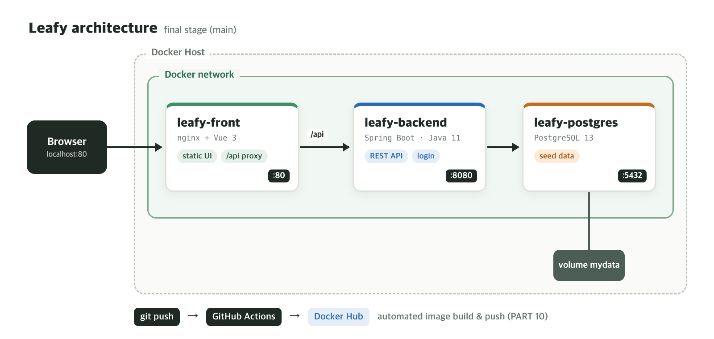
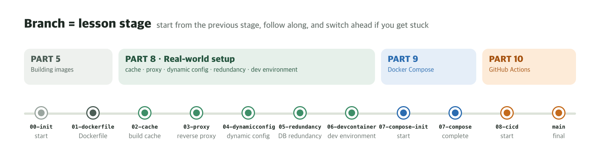

<p align="center"><b>English</b> | <a href="README.ko.md">한국어</a></p>

<p align="center">
  
</p>

<p align="center">
  
  
  
  
  
  
</p>

# 🌿 Leafy

**The main practice repository for the course *Easy Docker for Developers*.**

Leafy is a web app for keeping track of your plants: register them, log when you water them, and keep a care diary.
In the course, you take this one app all the way from building images → connecting containers → real-world setup → Compose → CI/CD.

<table>
  <tr>
    <td width="50%"></td>
    <td width="50%"></td>
  </tr>
  <tr>
    <td align="center">Home · my plants and recent diary</td>
    <td align="center">Plant catalog</td>
  </tr>
  <tr>
    <td width="50%"></td>
    <td width="50%"></td>
  </tr>
  <tr>
    <td align="center">Care diary</td>
    <td align="center">Login · one-click practice account</td>
  </tr>
</table>

<sub>The app's UI is in Korean.</sub>

---

## 🧭 Architecture

<p align="center">
  
</p>

| Folder | Role | Stack |
|---|---|---|
| [`leafy-frontend`](leafy-frontend) | UI. nginx serves the static files and forwards `/api` requests to the backend | Vue 3, Vuetify, nginx |
| [`leafy-backend`](leafy-backend) | REST API and login | Spring Boot 2.7, Java 11, Gradle |
| [`leafy-postgresql`](leafy-postgresql) | Database with seed data for the exercises | PostgreSQL 13 |

---

## 🌱 Branch = lesson stage

<p align="center">
  
</p>

Each branch is the **finished state** of one stage of the course.
To start an exercise, switch to the **previous stage's branch** and follow along. If you get stuck or want to skip ahead, switch to **that stage's branch**.

```bash
git clone https://github.com/daintree-henry/leafy.git
cd leafy
git switch 01-dockerfile
```

To discard your work and move to another branch, run this first:

```bash
git reset --hard HEAD && git clean -fd
```

| Branch | Course | What happens in this stage |
|---|---|---|
| `00-init` | PART 5 | Starting point. Source code only, no Dockerfiles |
| `01-dockerfile` | PART 5 | Build the frontend, backend, and DB into images |
| `02-cache` | PART 8 | Dockerfiles that make good use of the layer cache |
| `03-proxy` | PART 8 | Connect the API through an nginx reverse proxy |
| `04-dynamicconfig` | PART 8 | Pass settings as environment variables at run time |
| `05-redundancy` | PART 8 | Database redundancy |
| `06-devcontainer` | PART 8 | Develop and debug inside a container |
| `07-compose-init` | PART 9 | Getting started with Docker Compose |
| `07-compose` | PART 9 | The full service with Compose |
| `08-cicd` | PART 10 | Starting image build & push with GitHub Actions |
| `main` | PART 10 | Final state |

> 💡 Some branches contain things you will find and fix together during the course. Please follow the lessons in order.

---

## ⚡ Try it now

You can run the whole service right away with the finished images from the course.

```bash
docker network create leafy-network
docker run -d --name leafy-postgres --network leafy-network devwikirepo/leafy-postgres:1.0.0
docker run -d -p 8080:8080 -e DB_URL=leafy-postgres --network leafy-network --name leafy devwikirepo/leafy-backend:1.0.0
docker run -d -p 80:80 --network leafy-network --name leafy-front devwikirepo/leafy-frontend:1.0.0
```

Open **http://localhost** in your browser and click the orange one-click login button in the top-right corner.

| Practice account | |
|---|---|
| Email | `john123@qmail.com` |
| Password | `password123` |

To clean up:

```bash
docker rm -f leafy-front leafy leafy-postgres
docker network rm leafy-network
```

---

## 📺 Course

This repository contains the practice code for the course ***Easy Docker for Developers***. Follow it alongside the videos to go through each stage in order.

- Companion practice repository: [build](https://github.com/daintree-henry/build)
